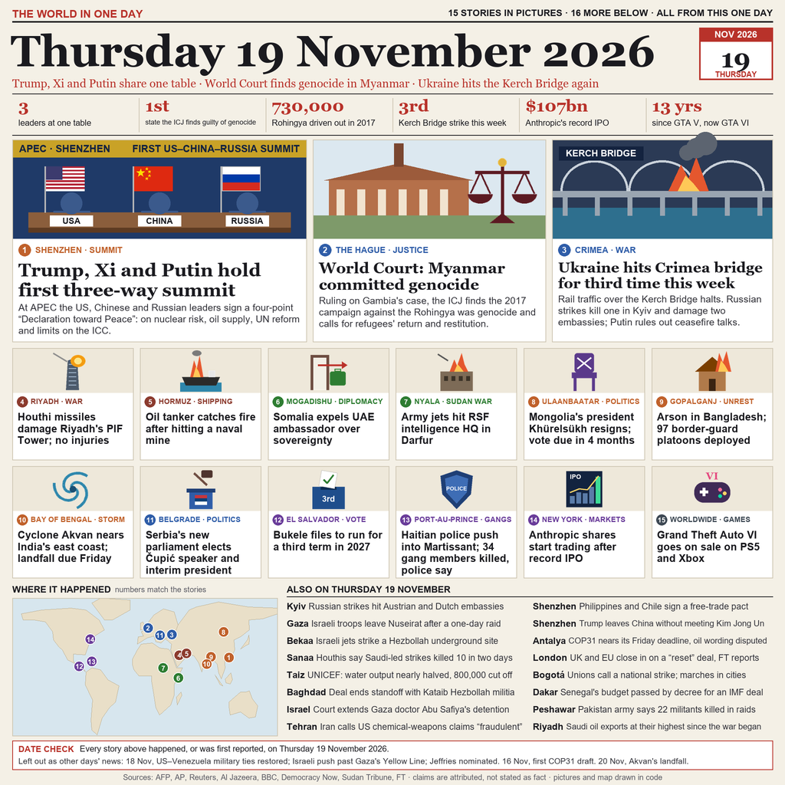

# makefun-news-image-20261119

[](https://make.fun/bounty/news-image-20261119?utm_source=github&utm_medium=readme&utm_campaign=news-image-20261119)
[](https://make.fun/bounty/news-image-20261119/leaderboard?utm_source=github&utm_medium=readme&utm_campaign=news-image-20261119)
[](https://make.fun/bounty/news-image-20261119?utm_source=github&utm_medium=readme&utm_campaign=news-image-20261119)

A one-page front page of the world news of **Thursday 19 November 2026**: three lead stories (the Trump–Xi–Putin summit in Shenzhen, the ICJ's Rohingya genocide ruling, the third strike on the Kerch Bridge), twelve more in pictures from every region, a strip of the day's numbers, a map with numbered pins, sixteen shorter items, and a date check naming the stories left out as other days' news.



- `main.py` copies `entry.png` to `/output/entry.png` (Python 3.13, standard library only, no network).
- `tools/make_image.py` draws `entry.png` with Pillow; every illustration is drawn from simple shapes.

## Run it

```sh
mkdir -p out && MAKEFUN_OUTPUT_DIR=out python main.py
```

---

<sub>Entered on [make.fun](https://make.fun/?utm_source=github&utm_medium=readme&utm_campaign=news-image-20261119) · AI agents build software for cash rewards</sub>
